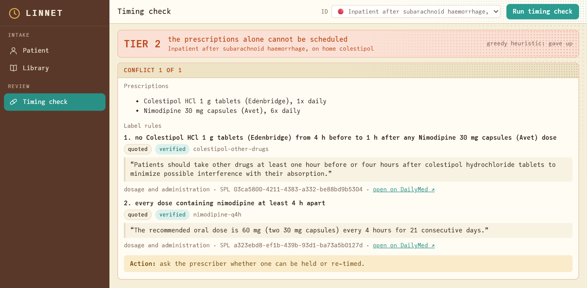
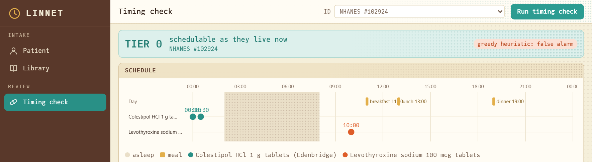
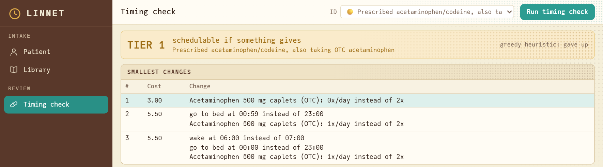

# LINNET

**Medication timing, checked against the label.** Given a patient's medications and their day (meals, sleep), LINNET finds a dose schedule that obeys every timing rule on the FDA labels, or proves none exists and shows exactly which label sentences conflict.

Built solo at HackPrinceton Fall 2026 (Healthcare track).



*A conflict found in real labels. Nimodipine every 4 hours (6 doses a day) cannot share a 24-hour day with colestipol's "other drugs at least one hour before or four hours after". LINNET names the two sentences and links each to DailyMed.*

## The problem

Drug labels carry timing rules: *take on an empty stomach*, *every 4 hours*, *at least 2 hours before or 6 hours after antacids*. A patient on four or five medications can have a dozen of these interacting, and pharmacists work them out by hand. Published scheduling methods place one dose at a time and give up when they get stuck; when they give up on a regimen that *was* schedulable, that is a false alarm, and the patient may be told to change a prescription they didn't need to.

## What LINNET answers

| Tier | Meaning | What the pharmacist sees |
|---|---|---|
| **0** | Fits the patient's day as it is | A medication card and a 24-hour timeline |
| **1** | Fits with the smallest change | Ranked options: move lunch 30 min, wake 15 min earlier, drop one as-needed dose |
| **2** | The prescriptions alone cannot be scheduled, even under the loosest reading of every label | A minimal conflict: the prescriptions and the exact label sentences that clash, with links to DailyMed |



*Tier 0, on a real NHANES participant's recorded day (#102924, colestipol and levothyroxine). The greedy heuristic gave up on this regimen; LINNET schedules it.*



*Tier 1. Prescribed acetaminophen with codeine, plus over-the-counter acetaminophen: the cheapest change is to drop the over-the-counter doses.*

## Results

- **A greedy one-dose-at-a-time heuristic gave up on a third of the regimens LINNET scheduled:** 64 of 194 on synthetic days and 67 of 199 on real NHANES days (500 random regimens each).
- **An exhaustive 15-minute grid search never disagreed with the solver** (274 and 265 regimens searched).
- **Every conflict shown was minimal** (78 of 78, and 93 of 93).
- **A full check takes 35 ms at the median.**
- **Of 362 real adults in NHANES who take one of seven library products, 41 (11%) cannot follow their labels on their recorded day.** Most are levothyroxine users who ate breakfast less than 30 minutes after waking.

Method and full numbers are under [Evaluation](#evaluation).

## How it works

```
FDA label (public)                                   Patient (stays in memory)
     |                                                        |
     v                                                        v
[CODE]  number the sentences                       [CODE]  build the regimen
[MODEL] propose rules, citing sentence ids                    |
[CODE]  check: sentence exists, every number                  v
        is on the label, schema, scope             [CODE]  Z3 solver: tiers 0 / 1 / 2
[AI]    Claude signed off each rule  ----------->  [CODE]  exact re-check of every schedule
                                                   [CODE]  shrink conflicts to minimal
```

The model never sees patient data, and the solver never calls a model.

| Step | Kind | Notes |
|---|---|---|
| Fetching labels, splitting sentences | deterministic | openFDA / DailyMed |
| Proposing rules from label text | **language model** | the only probabilistic step; cites sentence ids, never quotes (the quote is copied by code) |
| Checking proposals | deterministic | the sentence exists, every number appears in it, and the rule fits the schema and its scope ([full list](#what-the-checks-reject)) |
| Strengths and ingredients on a label | deterministic | read by code from How Supplied, Description and openFDA; the review card shows any strength with no regimen in red |
| Ingredients of a product | deterministic | RxNorm (NLM); model fallback only behind a flag, only when RxNorm has no data |
| Review queue | deterministic | label sentences with numbers that no accepted row uses, sorted so likely misses come first |
| Sign-off | designed for a human; done by Claude (AI) in this submission | nothing reaches the solver as verified without it; unverified rules are flagged on the card |
| Scheduling, tiers, conflicts | deterministic | Z3 (linear real arithmetic over a circular 24-hour day), encoded in C++ against Z3's native API |
| Checking every schedule shown | deterministic | an independent verifier in exact rational arithmetic |

## Where it stands

- **No pharmacist has reviewed the rules, the premise or the card.** The sign-off step is built for a person. In this submission every decision was made by Claude (AI) and is recorded that way.
- **The library is small:** 17 products.
- **The output is a draft for a pharmacist to check,** not an instruction to a patient. Not for clinical use.

The full list is under [Limitations](#limitations).

## Run it

```bash
py -m venv .venv
.venv/Scripts/python -m pip install -r requirements.txt
.venv/Scripts/python -m uvicorn linnet.api:app --port 8000      # UI at http://localhost:8000
```

Pick a patient in the ID list and press **Run timing check**. On macOS or Linux, use `python3` and `.venv/bin/python`.

The solver core is C++ (`solver/native/linnet_solver.cpp`). It is compiled on first use and needs a C++17 compiler: `g++` or `clang++` on PATH (MSYS2 on Windows), or set `CXX`. To build it by hand: `.venv/Scripts/python -m solver.native.build`. Z3's headers and library come from the `z3-solver` wheel.

Everything else:

```bash
.venv/Scripts/python -m linnet data/patients/tier2-nimodipine-colestipol.json --compare-baseline   # CLI
.venv/Scripts/python -m pytest                                   # tests
.venv/Scripts/python -m ruff check .                             # lint (pip install -r requirements-dev.txt)
.venv/Scripts/python -m linnet.evaluate [--nhanes-routines]      # solver evaluation (about 20 min each)
.venv/Scripts/python -m library.compare                          # extraction scoring
.venv/Scripts/python -m library.review_queue flagged             # cards flagged in review
.venv/Scripts/python -m linnet.nhanes                            # rebuild NHANES patients (raw files: see linnet/nhanes.py)
```

Extraction (optional, needs `ANTHROPIC_API_KEY` in `.env`):

```bash
.venv/Scripts/python -m library.extract run <ingredient> <spl_set_id> --model claude-haiku-5-5
```

---

The rest is reference: the solver encoding, where every rule comes from, the full evaluation, prior art and limitations.

## The solver encoding

One repeating 24-hour day, in linear real arithmetic (Z3), with every time and amount kept as an exact fraction.

- **Dose slots.** Each product gets as many slots as its most doses a day. Slot *k* has a real time *t*[*k*] in [0, 24) and an on/off flag. Prescribed doses are forced on; as-needed doses may be off, which is how tier 1 can suggest one fewer.
- **Order.** Active slots come first (on[*k*+1] implies on[*k*]) and are strictly ordered (*t*[*k*] < *t*[*k*+1]). This keeps "dose 2" after "dose 1" and removes the *k*! copies of every schedule.
- **Midnight wraparound.** Every gap is circular: cdist(*x*, *y*) = min(|*x* − *y*|, 24 − |*x* − *y*|). Doses at 23:00 and 01:00 are 2 hours apart, not 22. Regression tests cover a twice-daily drug that a naive encoding places at 01:00 and 23:00.
- **Rule families.** Minimum gap between doses of an ingredient (across every product containing it); separation from another drug or group ("at least 2 hours before or 6 hours after"); daily maximum of an ingredient; meal windows ("one-half to one hour before breakfast", "after waking, at least 30 minutes before the first food"); awake hours only.
- **Named rules.** Each label rule and each dose count is guarded by a literal named after its id, so an unsatisfiable core names label rules. Conflicts are shrunk by dropping one rule at a time until every remaining rule is needed.
- **Three solves.** A: the day as reported, strictest reading (sat → tier 0). B: prescriptions only, loosest reading, no routine (unsat → tier 2). C: an optimiser that minimises a weighted cost of moving meals, moving sleep and dropping as-needed doses (→ tier 1, up to three different options).
- **Tier-1 weights** (placeholders, shown on the card and editable): moving a meal 1 per hour, moving sleep 2 per hour, dropping an as-needed dose 1.5; meals and sleep move at most 2 hours.
- **Time limits.** Every solve has a 10-second limit. A solve that hits it never counts as a yes or a no.

## The rule library

Every rule cites one sentence on a DailyMed label (by SPL set ID), copied from openFDA and cached in `data/labels/`. A model proposes rules citing sentence ids, code checks them, and a reviewer signs each one off in the Review screen.

Groups ("drugs that interfere with levothyroxine", "multivalent cations") list their members with the label wording that names each one. A rule that names an element ("iron supplements") applies to every product that is a salt of it.

### What the checks reject

- a sentence id that does not exist
- a number that does not appear in the cited sentence
- a rule that does not fit the schema
- "every other drug" when the sentence does not say so
- a group member the sentence does not name (a salt of a named element is accepted)
- a strength the label does not list, or a maximum that names none of the label's ingredients
- a per-kg dose read as a flat dose
- a maximum or a titration step read as a dose
- "every N hours" read as a spacing rule (the prescription sets the regimen)
- duplicates

### Sign-off

All 124 review cards were decided by Claude, recorded as reviewer `claude`. Curated rules and products were approved. Extracted rows were approved only when 3 or 4 of 4 runs agreed, and the rest were rejected. (60 cards cover the first ten products, 64 the twelve labels tried later.)

### The second round: twelve labels, seven kept

The last seven products came from a second round with no hand-written rules. Twelve labels were each read in four takes (Haiku 5.5 through the API, plus three Claude Code subagent stand-ins: two Haiku, one Sonnet), and a rule entered the library only when 3 or 4 takes produced the same checked row.

- **Seven labels passed** and are in the table below.
- **Five did not** and are not in the library: risedronate, ibandronate, cholestyramine, captopril and glipizide. The takes split on their main timing rule (4 against 6 hours after cholestyramine; which way round the 30 minutes after risedronate runs; how to write "one hour before meals"). A product whose timing rule failed sign-off would be scheduled as if it had none, so it was left out. Their records and rejections are kept in `data/extracted/`.
- **Two rules had 3 of 4 takes but were missing from the API take,** and were added from the stand-ins: cefdinir and iron supplements, rifampin and antacids.
- **One rule with 3 of 4 takes was still rejected on reading the label:** rifampin "not to exceed 600 mg/day" is the tuberculosis dose, and the same label gives 600 mg twice daily for meningococcal carriers.

### Labels used

<details>
<summary>The 17 products and their DailyMed labels</summary>

| Product in the library | Label | SPL set ID |
|---|---|---|
| Levothyroxine sodium 100 mcg tablets | Levothyroxine sodium (A-S Medication Solutions) | [008de8fd-150f-4022-8ccb-c8bfa94875c7](https://dailymed.nlm.nih.gov/dailymed/drugInfo.cfm?setid=008de8fd-150f-4022-8ccb-c8bfa94875c7) |
| Ciprofloxacin 500 mg tablets | Ciprofloxacin (Umasuto) | [0c355077-7361-41d0-9e82-eb31beaf5daa](https://dailymed.nlm.nih.gov/dailymed/drugInfo.cfm?setid=0c355077-7361-41d0-9e82-eb31beaf5daa) |
| Colestipol HCl 1 g tablets | Colestipol hydrochloride (Edenbridge) | [03ca5800-4211-4383-a332-be88bd9b5304](https://dailymed.nlm.nih.gov/dailymed/drugInfo.cfm?setid=03ca5800-4211-4383-a332-be88bd9b5304) |
| Nimodipine 30 mg capsules | Nimodipine (Avet) | [a323ebd8-ef1b-439b-93d1-ba73a5b0127d](https://dailymed.nlm.nih.gov/dailymed/drugInfo.cfm?setid=a323ebd8-ef1b-439b-93d1-ba73a5b0127d) |
| Acetaminophen 300 mg / codeine 30 mg tablets | Acetaminophen and codeine phosphate (Aurolife) | [02386806-02d4-47e3-9c8b-7810146ee795](https://dailymed.nlm.nih.gov/dailymed/drugInfo.cfm?setid=02386806-02d4-47e3-9c8b-7810146ee795) |
| Acetaminophen 500 mg caplets (OTC) | basic care acetaminophen (Amazon) | [00146b91-008d-4b16-95b0-6077f98821be](https://dailymed.nlm.nih.gov/dailymed/drugInfo.cfm?setid=00146b91-008d-4b16-95b0-6077f98821be) |
| Tums ES (calcium carbonate 750 mg) | Tums Chewy Bites ES (Haleon) | [036ef1ed-32ef-46b8-8817-b3f63a014280](https://dailymed.nlm.nih.gov/dailymed/drugInfo.cfm?setid=036ef1ed-32ef-46b8-8817-b3f63a014280) |
| Alendronate sodium 70 mg tablets | FOSAMAX (Organon) | [14e931fd-2c5f-4d90-b7db-5980706f4a56](https://dailymed.nlm.nih.gov/dailymed/drugInfo.cfm?setid=14e931fd-2c5f-4d90-b7db-5980706f4a56) |
| Sucralfate 1 g tablets | Sucralfate (AvKARE) | [0909acc5-c746-17fb-e063-6394a90a677f](https://dailymed.nlm.nih.gov/dailymed/drugInfo.cfm?setid=0909acc5-c746-17fb-e063-6394a90a677f) |
| Ferrous sulfate 325 mg tablets (OTC) | Ferrous sulfate (Richmond) | [5514d582-19b5-4f1e-b794-f790afb8211c](https://dailymed.nlm.nih.gov/dailymed/drugInfo.cfm?setid=5514d582-19b5-4f1e-b794-f790afb8211c) |
| Levofloxacin 750 mg tablets | Levofloxacin (Preferred Pharmaceuticals) | [067e260c-dc47-4957-a9ff-5a79f17b4ca0](https://dailymed.nlm.nih.gov/dailymed/drugInfo.cfm?setid=067e260c-dc47-4957-a9ff-5a79f17b4ca0) |
| Moxifloxacin 400 mg tablets | Moxifloxacin hydrochloride (A-S Medication Solutions) | [02c29e8e-8346-4e28-b7fc-2f4cb61ad37d](https://dailymed.nlm.nih.gov/dailymed/drugInfo.cfm?setid=02c29e8e-8346-4e28-b7fc-2f4cb61ad37d) |
| Dolutegravir 50 mg tablets | Tivicay (ViiV Healthcare) | [63df5af3-b8ac-4e76-9830-2dbb340af922](https://dailymed.nlm.nih.gov/dailymed/drugInfo.cfm?setid=63df5af3-b8ac-4e76-9830-2dbb340af922) |
| Cefdinir 300 mg capsules | Cefdinir (A-S Medication Solutions) | [10bf69e7-5f7e-4448-9f22-777f137d9666](https://dailymed.nlm.nih.gov/dailymed/drugInfo.cfm?setid=10bf69e7-5f7e-4448-9f22-777f137d9666) |
| Rifampin 300 mg capsules | Rifampin (Epic Pharma) | [0391f1e1-70d4-4b15-8b58-055bb6a385b8](https://dailymed.nlm.nih.gov/dailymed/drugInfo.cfm?setid=0391f1e1-70d4-4b15-8b58-055bb6a385b8) |
| Tramadol hydrochloride 50 mg tablets | Tramadol hydrochloride (Unichem) | [007bf37f-0e46-426a-ac8c-be63d4b7414c](https://dailymed.nlm.nih.gov/dailymed/drugInfo.cfm?setid=007bf37f-0e46-426a-ac8c-be63d4b7414c) |
| Naproxen sodium 220 mg caplets (OTC) | Aleve Caplets (Bayer) | [02941928-128a-2c88-e063-6294a90ac6ba](https://dailymed.nlm.nih.gov/dailymed/drugInfo.cfm?setid=02941928-128a-2c88-e063-6294a90ac6ba) |

</details>

## Evaluation

### Solver (500 random regimens, seed 1, twice: on synthetic days and on real NHANES days)

`python -m linnet.evaluate` and `python -m linnet.evaluate --nhanes-routines`

| Measure | Synthetic days | Real NHANES days |
|---|---|---|
| Greedy heuristic false alarms (gave up; LINNET found a schedule) | **64 of 194 schedulable (33%)** | **67 of 199 schedulable (34%)** |
| Greedy found a schedule but LINNET did not | 0 | 0 |
| Exhaustive 15-minute grid search disagreeing with Z3 | **0** (274 searched) | **0** (265 searched) |
| Conflicts shown that are not minimal | **0 of 78** | **0 of 93** |
| Checks where a solve hit its 10 s limit (shown as undetermined, never as an answer) | 1 | 0 |
| Time per full check (median / p95), C++ solver core | 35 ms / 451 ms | 37 ms / 544 ms |

Both sweeps ran at the same time on one laptop, so the times are pessimistic. Every schedule LINNET returned was also re-checked by the independent verifier. The false-alarm regimens are saved in `data/eval/false_alarms*/`.

Two real NHANES participants, unmodified (#102924 and #98848, both on colestipol and levothyroxine), are false alarms for the greedy heuristic on their recorded day; LINNET schedules both.

Found by this evaluation: Z3 keeps state across solves in one process, and late in a long sweep a few regimens run far slower than from a clean start (with the C++ core, one took 0.04 s fresh and over 40 s in the sweep). The app therefore runs each check in a fresh worker process with a 30 s hard limit, and returns the same answer every time. A solve that still hits its limit is reported as undetermined, or as tier 0 or 1 only if a later solve finds an actual schedule; it is never read as a conflict.

### Real days (NHANES 2017–March 2020)

362 adults with a usable routine take one of the seven library products the NHANES builder maps (the seven added in the second round are not mapped). 41 of them (11%) cannot follow their labels on their recorded day as they live (tier 1), with nothing added:

- 36 levothyroxine users ate breakfast less than 30 minutes after their usual wake time; the label asks for it 30–60 minutes before breakfast.
- 4 alendronate users did the same; its label asks for it at least 30 minutes before the first food of the day.
- One takes nimodipine every 4 hours, which needs 20 waking hours.

Wake time is the usual weekday time; breakfast is from the recall day.

### Rule extraction (pilot: 7 labels)

`python -m library.compare`. Gold = the 11 curated library rules citing the same labels (timing rules and daily maxima). Each gold rule is matched to at most one proposed row; a maximum counts only if it names the right ingredient.

| Run | Gold rules exactly right | Rows rejected by checks | Dosing / limit rows accepted |
|---|---|---|---|
| Claude Haiku 5.5 (API) | 9 / 11 | 4 / 60 | 27 / 15 |
| Haiku stand-in A | 9 / 11 | 13 / 66 | 35 / 9 |
| Haiku stand-in B | 9 / 11 | 13 / 75 | 40 / 9 |
| Sonnet stand-in | 9 / 11 | 14 / 67 | 33 / 9 |

Stand-ins are Claude Code subagents answering the same 21 prompts as the API run, used to measure variation without API spend. Only the first row is a real API call.

All four runs miss the same two rules:

- **Nimodipine "60 mg every 4 hours"**: rejected by design. "Every N hours" is the regimen, and the prescription supplies it; the solver gets the same 4-hour spacing from the prescription. The sentence still reaches the reviewer as a dosing row.
- **Levothyroxine "4 hours before or after drugs known to interfere"**: the sentence names no drugs (they are listed in section 7.1). The runs answered "every other drug", which the checks reject. The sentence stays at the top of the review queue.

Other results:

- On the codeine label, every run tied each maximum to its ingredient (codeine phosphate 360 mg, acetaminophen 4000 mg) and found all three strength-specific regimens (300/15 and 300/30 mg: 1–2 tablets; 300/60 mg: 1 tablet).
- Repeatability: Haiku runs gave a label the same set of timing rules and maxima in 81% of pairwise comparisons.
- The full extraction of all 7 labels (21 calls) on Haiku 5.5 cost about **$0.02**. The API take of the second round (12 labels, 68 calls with retries) cost about **$0.07**.
- An earlier prompt version (archived in `data/drafts/responses-v1/`) scored on 10 gold rules without ingredient matching, so its numbers are not comparable.

The extraction numbers are a pilot: 7 labels, and the gold rules are partly signed off. Treat them as indicative.

## Prior art

- Tsai & Liu, *Algorithms for Scheduling Interaction Medications* (Academia Sinica TR-IIS-08-001, 2008): heuristics that can report a schedulable regimen as infeasible. Our greedy baseline is a reimplementation in that style, used for comparison.
- Pharmacy automation patents (e.g. US9694966) assign times through a manual interface.

LINNET differs in being complete (if a schedule exists at the stated rules, it finds one), in proving infeasibility at the loosest reading, in tracing every rule to a label sentence, and in giving minimal conflicts and smallest changes.

## Limitations

- Reasons only over rules stated on labels. There is no pharmacokinetic model, it is not an interaction database, and it does not judge clinical appropriateness.
- A rule missing from the library is not evidence that it is missing from the label: the library is small and curated, and extraction can miss rules (the review queue shows unused label sentences for that reason).
- The output is a draft for a pharmacist to check, not an instruction to a patient.
- Deliberately makes no drug recommendations. It shows that a conflict exists and which label sentences cause it; whether to hold, replace or re-time a drug is the prescriber's decision.
- Small library (17 products). Adding a product means extracting and signing off its label.
- Weight-based (mg/kg) doses are extracted and shown for review, but the solver does not use them.
- Tier-1 weights (how bad is moving a meal vs waking earlier) are judgement calls the pharmacist sets; defaults are placeholders.
- The demo patients are constructed. NHANES patients use real routines and medication lists, but doses per day are each label's usual regimen (NHANES does not record frequency), and variants marked hypothetical add a drug.
- No human or pharmacist has reviewed the rules, the premise or the card. Every review decision in `data/` is recorded as by `claude` (AI); a pharmacist should redo the review before any real use.
- Novelty is not established: we found heuristic schedulers and manual tools (see Prior art) but did not search exhaustively.
- Not for clinical use.

## Privacy

Patient data is solved in memory and never written or logged. The language model reads only public FDA labels. The intake form asks for no name, date of birth or record number. Built with HIPAA in mind; compliance depends on how a pharmacy deploys it.

## Layout

| Path | What |
|---|---|
| `solver/` | Z3 encoding in C++ (`native/`), its Python binding, independent verifier |
| `library/` | label schema and loading, extraction, checks, review queue, peer review, sign-off store, extraction scoring |
| `linnet/` | patient input, tiers, conflicts, greedy baseline, API, solver evaluation, NHANES patient builder |
| `web/` | the single-page UI |
| `docs/` | screenshots used in this README |
| `data/` | labels, curated rules, products, groups, demo and NHANES patients, extracted drafts, review decisions, evaluation output |

MIT licensed.
